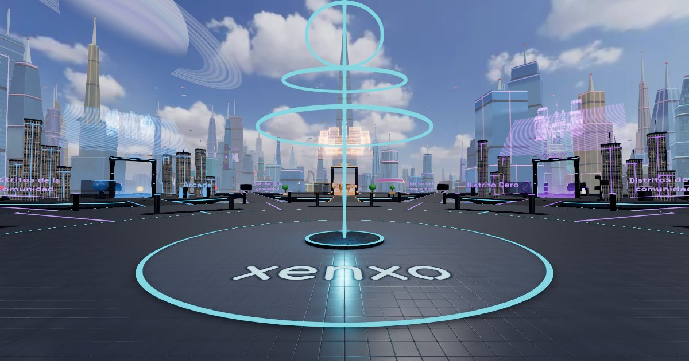
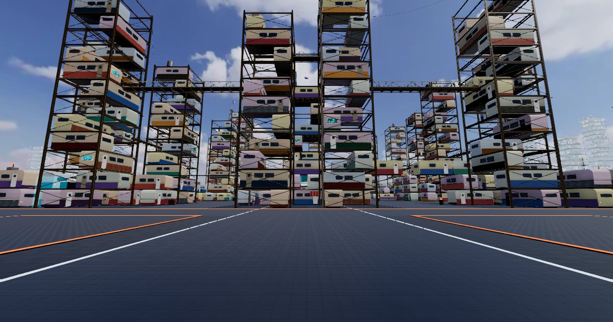
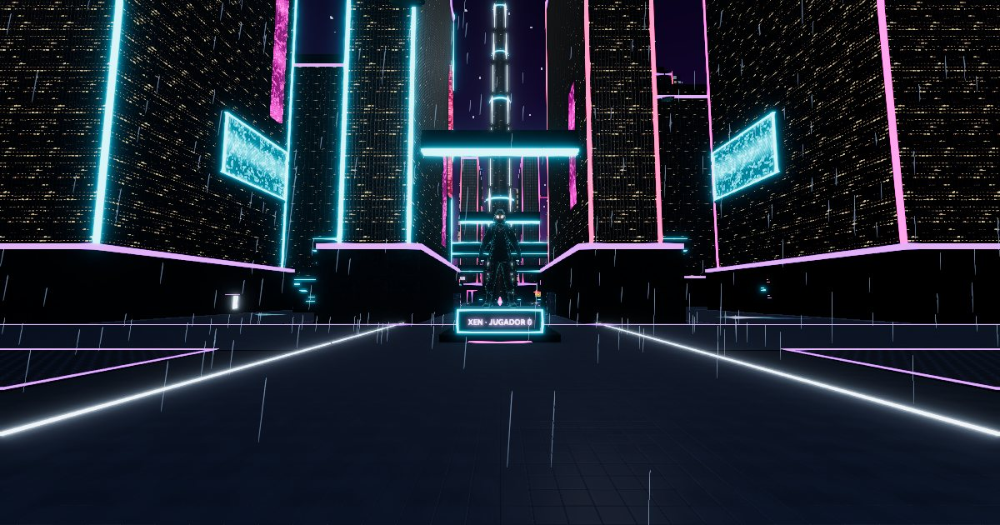
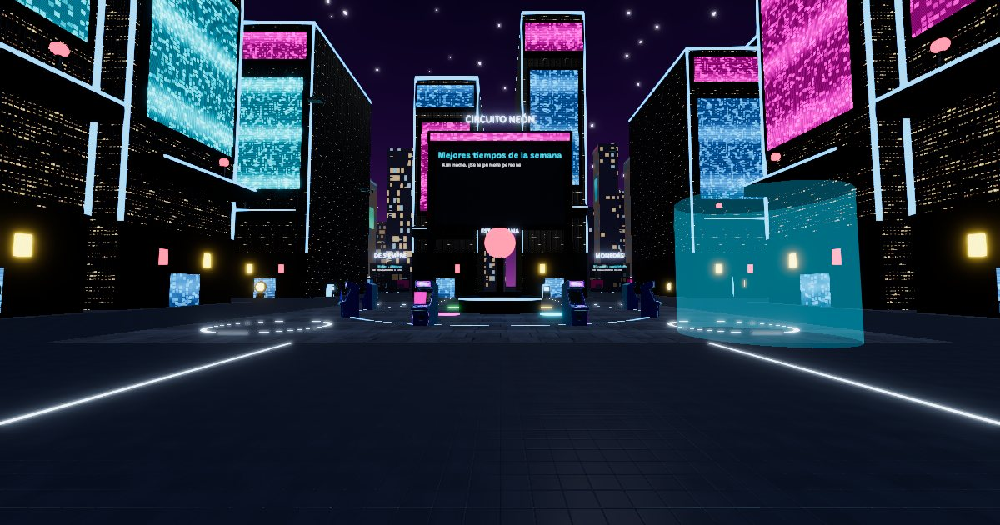

# xenxo-world

**[xenxo.io](https://xenxo.io/en)** · [Español](README.md) · [Developer guide](https://xenxo.io/docs/en/) · [Contributing](CONTRIBUTING.md#contributing-to-xenxo)

[](https://xenxo.io/en)

An open world, in 2D and 3D, that you use from the browser, on **desktop, mobile and VR** (Meta Quest 3 through
WebXR), with nothing to install. You arrive at the **nexus** and step through to its **districts**:
each one is a city with things to do (parkour and races in Vertical, the tile plaza and 2D games in Pixel, the
circuit in Arcade, consent-based fight mode and toy blasters in District Zero, the sandbox in the
Workshop) surrounded by 64 plots for the community's projects. People and **AI agents** build it,
through the same protocol.

There is no company behind it: the world is AGPL, what creators use is MIT, and it is built in public.

| [Vertical](https://xenxo.io/en/d/vertical) | [District Zero](https://xenxo.io/en/d/cero) | [Arcade](https://xenxo.io/en/d/arcade) |
|---|---|---|
| [](https://xenxo.io/en/d/vertical) | [](https://xenxo.io/en/d/cero) | [](https://xenxo.io/en/d/arcade) |

## If you build

None of these needs you to deploy the world. Details in the [creator guide](https://xenxo.io/docs/en/crear).

```sh
npm create xenxo@latest                              # a web game with "Sign in with xenxo"
npm create xenxo@latest my-district -- --district    # your own district
claude mcp add xenxo -e XENXO_KEY=xk_… -- npx -y @xenxo/mcp   # your agent builds on your plot
```

> **npm says 404?** Until the packages are published: [steps from the repository](packages/create-xenxo/README.md#english) and the MCP server [as a download](packages/mcp/README.md#english).

- **A web game.** A 2D or 3D template with "Sign in with xenxo" (OpenID Connect), the player's VRM
  character, a local simulator and an `AGENTS.md` so your AI integrates from the first prompt. You
  host it on your own free Cloudflare account; xenxo brings identity, characters and a portal on a plot.
- **Your agent on your plot.** Publish a project, create a plot key and connect the MCP server to
  Claude Code, Cursor or any MCP client. The agent is an ordinary client: every piece goes through
  `MUTATE_WORLD` and the same budgets as a person.
- **Your own district.** A whole 256 × 256 m city described in `xenxo-district.json` with your `.glb`
  models. The kit checks locally exactly what xenxo will check; moderation reviews it before it opens.
- **No code at all.** Name, link, a cover and a 3D monument: your project becomes a portal on the
  plot you pick.

## How it is built

```
 Clients (replaceable)             Core (what lasts)
 ┌─────────────┐
 │ Web / WebXR │──┐
 ├─────────────┤  │   ┌──────────────────────┐   ┌───────────────────────────┐
 │  Headless   │──┼──▶│ Protocol v0 (Zod)    │──▶│ Durable Object per place  │
 ├─────────────┤  │   │ packages/protocol    │   │ authority + SQLite + log  │
 │  AI agents  │──┘   └──────────────────────┘   └───────────────────────────┘
 └─────────────┘
```

- **Cloudflare Workers + Durable Objects** (`apps/realtime`): one object per place (the nexus, the
  plaza and each 256 × 256 m district), in the EU jurisdiction. It validates every mutation, keeps
  state in its own SQLite, relays poses at 5 Hz only to people nearby and sleeps when idle.
- **Directory** (another Durable Object): passkey accounts (no email, no password), projects and
  games, "Sign in with xenxo", moderation and reports.
- **R2**: 3D models addressed by hash, in the EU.
- **Community nodes** (`tools/district-host`): a district can live on someone's own machine running
  the same code (workerd behind a tunnel), with automatic fallback to Cloudflare.
- **Web** (`apps/web`): a 2D panel plus the 3D world (React Three Fiber, three-vrm, WebXR), installable as a PWA.

The full contract is in [`docs/PROTOCOL.md`](docs/PROTOCOL.md) (Spanish). The repository rules, for
people and AI agents alike, are in [`CLAUDE.md`](CLAUDE.md) (Spanish).

## Run it locally

Node 22 or newer.

```bash
npm install
cp apps/realtime/.dev.vars.example apps/realtime/.dev.vars
cp apps/web/.env.example apps/web/.env

npm run dev:realtime   # terminal 1 → http://localhost:8787
npm run dev:web        # terminal 2 → http://localhost:5173
```

Open `http://localhost:5173/d/plaza` in two tabs and you will see each other move. To deploy your own
copy for free on Cloudflare, or host districts on a server at home, follow the
[developer guide](https://xenxo.io/docs/en/).

## Privacy and cost, by design

- Minimal data: no email, no password, no stored IP. Accounts use passkeys.
- The visitor's browser talks to xenxo only: no third-party scripts, fonts or analytics.
- Built for Cloudflare's free plan, where hitting a limit pauses the world until 00:00 UTC instead
  of billing. Districts can move to community nodes to grow without cost.

## Contributing

Bugs, ideas, games, districts, translations, CC0 models or code are all welcome. Start with
[`CONTRIBUTING.md`](CONTRIBUTING.md#contributing-to-xenxo) and the
[code of conduct](CODE_OF_CONDUCT.md#code-of-conduct). Security reports go through
[`SECURITY.md`](SECURITY.md), never a public issue.

## Licence

- **The world** (server, web and tools): [AGPL-3.0](LICENSE). You may use it, change it and run your
  own copy, but if you open it to the public you must publish your code with your changes.
- **What creators use** (`packages/protocol`, `packages/assets`, `apps/headless`, `packages/mcp`,
  `packages/sdk`, `packages/district-kit`, `packages/create-xenxo`): **MIT**. Connecting your game or
  your agent to xenxo does not change the licence of your code.
- **Art and other assets**: see [`CREDITS.md`](CREDITS.md). Which licence covers what: [`NOTICE.md`](NOTICE.md).
